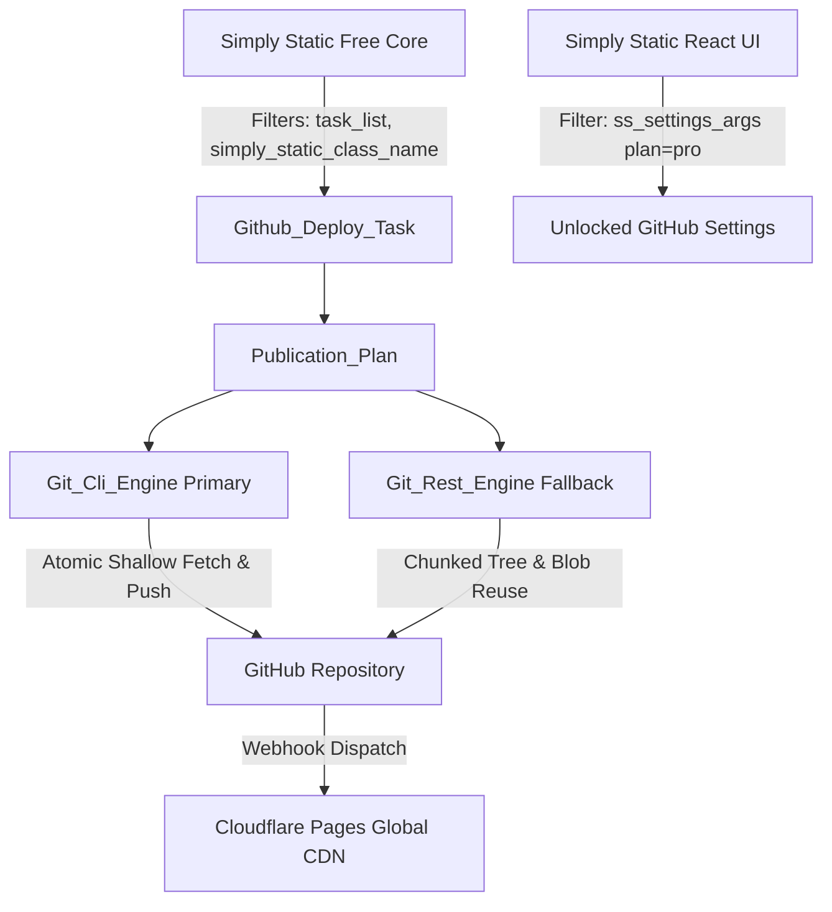

# Codebase Architecture & Technical Reference

**Package:** `codev-simply-static-companion`  
**Namespace:** `Codev\Simply_Static_Companion`  
**Repository:** `syamsulalam/codev-simply-static-companion`  
**Last Updated:** 2026-11-16 (Asia/Jakarta)  

---

## 1. System Architecture Overview

`codev-simply-static-companion` is a modular, high-performance companion plugin for Simply Static Free that unlocks direct GitHub static deployments (matching and exceeding Simply Static Pro) without modifying Simply Static core files.

---

## 2. File & Class Inventory

| File Path | Class / Entrypoint | Responsibilities |
|---|---|---|
| `codev-simply-static-companion.php` | Root bootstrap | PSR-4 autoloader, early WP-CLI registration, `plugins_loaded` priority 20 boot. |
| `src/class-plugin.php` | `Plugin` (Singleton) | Hooks `task_list`, `simply_static_class_name`, `ss_settings_args`, feature loaders. |
| `src/Tasks/class-github-deploy-task.php` | `Github_Deploy_Task` | Subclass of `Simply_Static\Task`. Inherits `protected $options`. Executes publication and returns `bool\|\WP_Error`. |
| `src/Engines/class-publication-plan.php` | `Publication_Plan` | Normalizes target paths, base commit SHA, destination prefix (`github_folder_path`), and protected paths (`.clients`, `.github`, `_routes.json`). |
| `src/Engines/class-git-cli-engine.php` | `Git_Cli_Engine` | Ephemeral shallow Git CLI deployment with advisory locks (`.worker.lock`), process timeouts (`proc_open`), path containment, and link defense. |
| `src/Engines/class-git-rest-engine.php` | `Git_Rest_Engine` | Pure PHP GitHub Git Database REST API fallback with blob SHA reuse and transient rate-limit backoff. |
| `src/Hardening/class-cloudflare-edge.php` | `Cloudflare_Edge` | Cloudflare Pages edge defenses: duplicate `404/index.html` to root `404.html`, safe `_headers` (media-only immutable cache), and `_redirects`. |
| `src/Hardening/class-asset-sniffer.php` | `Asset_Sniffer` | Automatically scans dynamic Elementor (`post-{id}.css`) and Spectra (`uag-plugin/assets`) CSS files and injects them into export crawls. |
| `src/Features/class-single-export.php` | `Single_Export` | Incremental single post/page auto-export on `save_post` with queue coalescing and non-destructive diff overlays. |
| `src/Features/class-webhooks.php` | `Webhooks` | Post-commit notifications to GitHub Repository Dispatch and WhatsApp LusmoBot with SSRF protection against private IP spaces. |
| `src/CLI/class-cli-commands.php` | `CLI_Commands` | WP-CLI headless fleet commands: `wp simply-static-codev export-and-deploy/single/status` using `get_archive_creation_job()`. |
| `tests/review_core.py` | Python test driver | Static qualification suite auditing findings F01–F06 and AP-01–AP-06. |

---

## 3. Hardening & Edge-Case Audit Ledger

This ledger centralizes edge cases, vulnerabilities, architectural pitfalls and mitigations from Engineer Sol and Open Code Review (OCR). The current review disposition below controls acceptance; individual mitigation descriptions do not establish full certification.

### Current certification disposition — 2026-11-16 re-review

**Latest: REPAIR PASS; FULL CERTIFICATION NOT QUALIFIED** for engine commit `8175827f59f488674f7b7b9e34ebbf1c706e8e41`. Codex independently ran both original and follow-up probes with `--assert-safe`; both pass. Edge Cases 7/8 are closed at the tested boundaries. PHP syntax lint passes. The inherited open requirements listed below remain unchanged; no full-contract certificate has been granted. The following 7294ceb account is retained as historical evidence, superseded for the two bypasses by this decision.

**REVISION REQUIRED — CERTIFICATION WITHHELD** for engine commit `7294ceb474e2fe5f11eb15df53a123ba4892e566`. Codex independently reran the original certification probe with `--assert-safe`: exit 0. All six submitted regression examples pass at the exercised boundaries; original F01–F06 acceptance is unchanged.

Two existing containment requirements still fail in disposable runtime tests: `delete_directory_recursive(get_tenant_work_root() . '/../outside')` deletes an outside sentinel (AP-01), and an ancestor junction into a sibling named `workspace-neighbor` bypasses the physical prefix check and overwrites an outside sentinel (AP-01/AP-06). The follow-up regression driver is `C:/Users/THINKPAD/OneDrive/MD/REPORT/sol_companion_certification_followup_20261116.py`; `--assert-safe` must reject this revision.

Open inherited requirements: canonical root/ancestor and source containment, prefix validation before every mkdir, owner-bound reservation/deletion, lock exclusion through removal, legacy owner/drain checks, checked Git config/HEAD results and full commit identity, supervised descendant termination, verified private tenant roots, and independent cleanup recovery. Windows/Linux production and GitHub canary qualification remain incomplete. The current `tests/review_core.py` AP checks establish static markers only, despite their stronger printed message. A passing example is not full gate closure.

Authoritative review and integrated repair direction: `C:/Users/THINKPAD/OneDrive/MD/REPORT/REPORT-SOL-FINAL-COMPANION-CERTIFICATION-2026-11-16.md`, current re-review section. No plugin implementation changes were made by this review.

### 3.1 Initial Architectural Review (Findings F01 to F06)

* **F01: Protected Property Narrowing in `Github_Deploy_Task`**
  - *Problem:* Subclassing `Simply_Static\Task` and declaring `private $options` broke visibility on upstream methods that access `protected $options`.
  - *Mitigation:* Removed duplicate property; strictly reuse inherited `protected $options`.
* **F02: `perform(): bool` Contract Swallowing `WP_Error`**
  - *Problem:* Strict `:bool` return type prevented `perform()` from returning `\WP_Error`, causing archive runner to think tasks succeeded when pushes failed.
  - *Mitigation:* Removed `:bool` return type; return `bool|\WP_Error` so archive runner cleanly logs and halts on failures.
* **F03: Destructive Push & Blind Repository Wipes in Single Exports**
  - *Problem:* Force-pushing (`push -f`) or creating orphan branches wiped unrelated static pages during incremental post exports.
  - *Mitigation:* Native Git CLI overlays diff onto shallow base branch (`--depth 1`) and pushes with conflict-safe fast-forward (`push origin HEAD:refs/heads/<branch>`).
* **F04: Cloudflare Pages Immutable Cache Trapping Dynamic CSS**
  - *Problem:* Applying `immutable` caching to all files in `/wp-content/uploads/` prevented browser cache invalidation for dynamically generated Elementor/Spectra CSS files.
  - *Mitigation:* Confined `Cache-Control: immutable` strictly to fingerprinted media extensions (`png|jpg|webp|avif|woff2|mp4`). Applied `must-revalidate` to CSS and JS assets.
* **F05: Blocking `sleep()` in PHP-FPM Workers upon GitHub Rate Limits**
  - *Problem:* Calling `sleep($seconds)` upon GitHub 403 rate limits exhausted PHP-FPM worker pools, causing 504 Gateway Timeouts.
  - *Mitigation:* Implemented non-blocking transient backoff (`codev_ss_github_ratelimit`). Immediately returns pending state to resume later.
* **F06: WP-CLI Direct Access to Protected Properties**
  - *Problem:* Direct access to `->archive_creation_job` broke in Simply Static Free.
  - *Mitigation:* Invoked public accessor `\Simply_Static\Plugin::instance()->get_archive_creation_job()`.

---

### 3.2 Git CLI Auto-Pruning Hardening (Findings AP-01 to AP-06)

* **AP-01: Path Containment & Symlink Traversal Escape**
  - *Problem:* Unrestricted deletion helper and string prefix checks allowed directory traversal or external sentinel deletion through symlinks/junctions.
  - *Mitigation:* `is_path_within_authorized_root()` restricts deletions strictly to authorized tenant directories. `delete_directory_recursive()` deletes links directly without traversing targets.
* **AP-02: Advisory Worker Locking vs Blind Age Deletion**
  - *Problem:* Startup sweepers deleting directories based solely on age (>30m) killed long-running active exports.
  - *Mitigation:* Active exports hold an exclusive advisory file lock (`flock($fp, LOCK_EX | LOCK_NB)` on `.worker.lock`). Sweeper only deletes directories where acquiring `LOCK_EX | LOCK_NB` succeeds.
* **AP-03: Fetch Failure Masking as Empty Repository**
  - *Problem:* Catch-all fallbacks treated network or authentication failures during `git fetch` as an empty repository.
  - *Mitigation:* Validates branch ref format (`check-ref-format`). On fetch failure, queries `git ls-remote`. If remote branch exists or query fails, it fails closed with `WP_Error('git_fetch_failed')`.
* **AP-04: Cleanup Error Visibility & Structured Reporting**
  - *Problem:* Silent suppression with `@` hid file-locking cleanup failures.
  - *Mitigation:* `teardown_workspace(): bool` returns boolean status. `deploy()` evaluates return outside `try` block and attaches `cleanup => pending` with diagnostic warnings.
* **AP-05: Process Timeout Enforcement & Secret Masking**
  - *Problem:* Unbounded `exec()` calls hung indefinitely on network prompts, leaving worker processes and locks orphaned.
  - *Mitigation:* Replaced `exec()` with `proc_open()` enforcing a 60s timeout via non-blocking stream loop with `stream_select()`. Terminated hung children via `proc_terminate()`. Replaced PAT in output with `***GITHUB_PAT***`.
* **AP-06: Storage Privacy Outside Web Root**
  - *Problem:* Workspaces in `wp-content/uploads/` were publicly accessible over HTTP.
  - *Mitigation:* Moved workspace root to private OS temp directory (`sys_get_temp_dir() . '/codev-ss-work-' . $user`) created with `0700` permissions.

---

### 3.3 Final Certification Hardening (Ancestor Junctions, Process PATH & Git Excludes)

* **Edge Case 1: Ancestor Junction Traversal in `overlay_files()`**
  - *Problem:* Checking only `$dst_file` and immediate `dirname($dst_file)` allowed file copying through an upper ancestor junction/symlink outside the workspace.
  - *Mitigation:* `is_safe_overlay_path()` walks every ancestor segment between the workspace root and destination file. If any segment is a link (`is_link()`) or if `realpath()` escapes the workspace boundary, it aborts with `symlink_injection_detected`.
* **Edge Case 2: Protected Destination Prefix Directory Mutation**
  - *Problem:* `wp_mkdir_p()` was called on `destination_prefix` before validating protected paths, creating directories like `.git/injected`.
  - *Mitigation:* Validates `destination_prefix` against `is_protected_path()` and `.git` prefixes BEFORE creating any directories.
* **Edge Case 3: `.worker.lock` Staged into Remote Git Repository**
  - *Problem:* Placing `.worker.lock` inside the workspace root caused `git add -A` to stage and commit the lock file to GitHub.
  - *Mitigation:* Added `.worker.lock` to `.git/info/exclude` upon repository initialization and added explicit unstage command (`git rm --cached -f .worker.lock`).
* **Edge Case 4: `deploy()` Cleanup Warning Dropped by PHP Try Return Semantics**
  - *Problem:* In PHP, returning `$result` from inside a `try` block evaluates the return value before `finally` modifies `$result`, dropping `cleanup => pending`.
  - *Mitigation:* Separated deployment execution into private helper `$this->execute_deployment()` and returned `$result` outside the `try` block after `finally` finishes modifying it.
* **Edge Case 5: Loss of `PATH` in `proc_open()` under Default PHP `variables_order=GPCS`**
  - *Problem:* Under default Windows PHP CLI, `$_ENV` is empty. Passing `array_merge($_ENV, ...)` passed an empty environment to `proc_open()`, causing `git` command not found errors.
  - *Mitigation:* Used `getenv()` which retains all system environment variables (including `PATH` and `SystemRoot`) regardless of `variables_order`.
* **Edge Case 6: Unconditional Legacy Root Deletion**
  - *Problem:* Startup sweep deleted entire legacy directories unconditionally, wiping fresh files created during migrations.
  - *Mitigation:* Applied `$max_age_seconds` (>30m) check to legacy entries before pruning.
* **Edge Case 7: Traversal Escape through `..` in `is_path_within_authorized_root()`**
  - *Problem:* A path like `get_tenant_work_root() . '/../outside'` started textually with `$root . '/'`, bypassing the authorization check.
  - *Mitigation:* Explicitly rejected any path containing `..` (`str_contains($norm_dir, '..')`) and enforced canonical `realpath()` validation against the authorized root.
* **Edge Case 8: Sibling Prefix Escape in `is_safe_overlay_path()`**
  - *Problem:* `str_starts_with($norm_real_dir, $norm_real_work)` without a trailing slash allowed writing to sibling directories sharing the workspace name prefix (e.g. `workspace-neighbor`).
  - *Mitigation:* Enforced exact equality OR strict slash-delimited prefix check: `$norm_real_dir === $norm_real_work || str_starts_with($norm_real_dir, $norm_real_work . '/')`.
